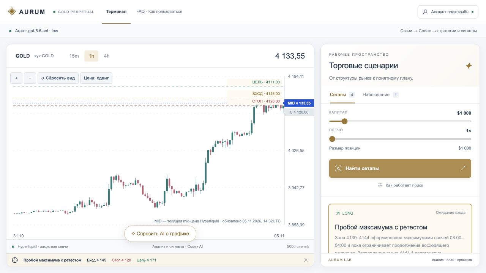
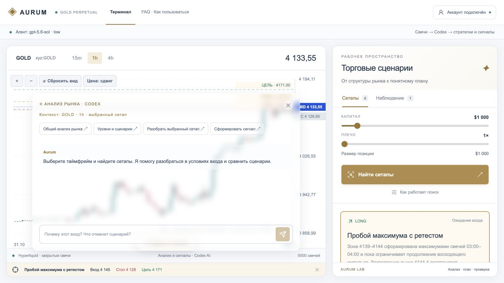
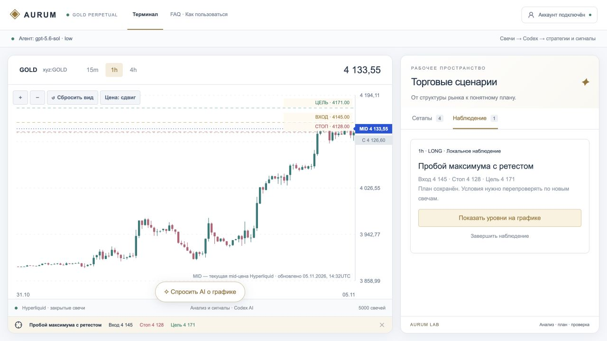
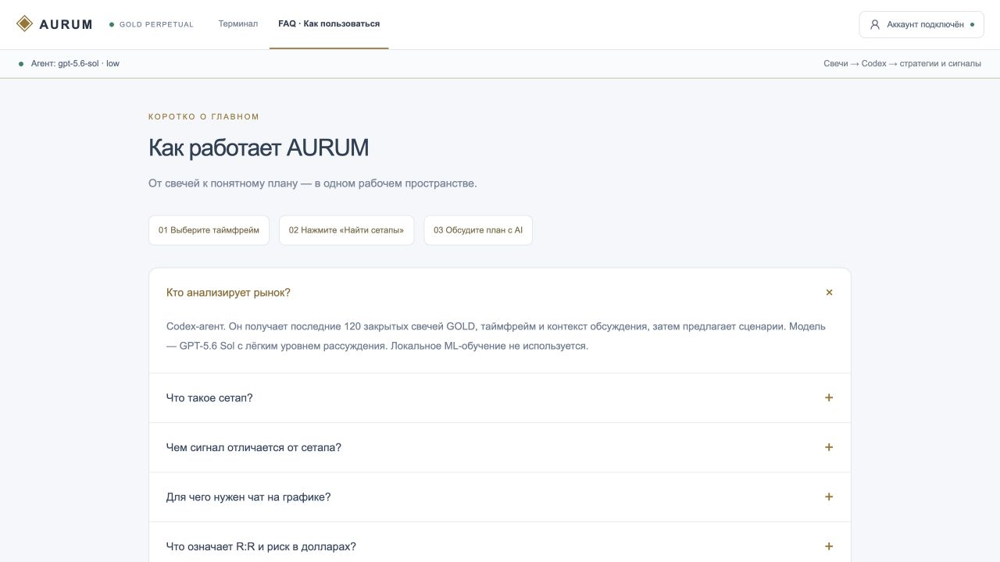

# AURUM

«Разработка интеллектуальной системы поиска торговых стратегий и формирования торговых сигналов на основе искусственного интеллекта».

## Возможности в скриншотах

### Терминал и торговые сценарии

Свечной график GOLD с переключением таймфреймов 15m / 1h / 4h. Справа — параметры капитала и плеча, поиск сетапов и карточки сценариев. Выбранный план показывает на графике вход, стоп и цель.



### Обсуждение рынка с AI

Чат открывается поверх графика и учитывает выбранный таймфрейм и сетап. Можно запросить общий анализ, разобрать уровни и сценарии, обсудить выбранный план или сформировать сигнал.



### Локальное наблюдение за планом

Сохранённый план содержит направление, таймфрейм, вход, стоп и цель. Его уровни можно снова показать на графике или завершить наблюдение. Добавление в список не отправляет торговую заявку.



### Справка внутри приложения

Раздел FAQ объясняет последовательность работы, смысл сетапов и сигналов, расчёт риска и источники данных.



Скриншоты показывают состояние интерфейса на 5 ноября 2026 года. Цены и планы приведены для демонстрации функций; сохранённые сценарии требуют повторной проверки по новым свечам.

## Как работает система

1. Hyperliquid предоставляет закрытые OHLC-свечи xyz:GOLD (15m, 1h, 4h). Архив хранится в SQLite, новые свечи запрашиваются раз в минуту.
2. По запросу пользователя Codex получает последние 120 закрытых свечей, таймфрейм, капитал, плечо и контекст обсуждения.
3. Агент самостоятельно интерпретирует рынок и предлагает стратегии: направление, вход, стоп, цель, подтверждение и отмена. При отсутствии условий допускается пустой результат.
4. Код проверяет формат ответа, порядок положительных ценовых уровней и R:R ≥ 1,5. Размер позиции и риск рассчитываются арифметически.
5. Отдельный запрос агенту формирует сигнал LONG / SHORT / WAIT с обоснованием и сроком актуальности. Это интерпретация агента, а не автоматическое исполнение сделки.

Локального ML, логистической регрессии, обучения на свечах, перебора технических стратегий и исторического рейтинга доходности нет. График рисует свечи и уровни выбранного плана Codex. Отсутствие рыночных данных отображается явно; искусственные котировки не подставляются.

## Интерфейс

Терминал содержит график, сетапы, локальное наблюдение и прозрачный чат Codex. Верхнее меню открывает поиск стратегий, сигналы AI, историю обсуждения, настройки и методику. Наблюдение не отправляет заявки и не исполняет стратегии.

Планы, список наблюдения, выбранный план и таймфрейм сохраняются в localStorage (`aurum-terminal-v2`). После перезагрузки выбранные уровни восстанавливаются. Старый список `aurum-watch-v1` поддерживается. Сохранение не означает, что сигнал остаётся актуальным: перед действием нужна новая оценка свечей агентом.

## Локальный запуск

### Что установить

- **Node.js ≥ 22.13.0** — [официальная страница загрузки](https://nodejs.org/en/download). Выберите поддерживаемую LTS-версию, удовлетворяющую этому требованию. npm устанавливается вместе с Node.js; [официальная инструкция npm](https://docs.npmjs.com/downloading-and-installing-node-js-and-npm/).
- **Git** — [официальная установка для Windows, macOS и Linux](https://git-scm.com/install/). Нужен для клонирования репозитория и отправки изменений.

Проверьте установку в терминале:

```sh
node --version
npm --version
git --version
```

React, TypeScript, Vite, Wrangler и остальные зависимости устанавливаются командой `npm install` из `package.json`. SQLite встроен в используемый Node.js: отдельный сервер базы данных устанавливать не требуется. Для получения свечей и работы AI нужен интернет.

### Скачать и запустить

```sh
git clone https://github.com/neflork/aurum-lab.git
cd aurum-lab
```

В папке проекта выполните:

```sh
npm install
npm run dev
```

Откройте адрес из вывода сервера. Если агент не подключён, нажмите «Подключить агента» или выполните `npm run ai:login`. Локальный мост использует существующий вход через ChatGPT.

Модель по умолчанию: `gpt-5.6-sol`, уровень рассуждения `low`. Переопределения: `AURUM_AI_MODEL`, `AURUM_AI_EFFORT`. После изменения перезапустите мост.

```sh
npm run ai:bridge
npm run ai:status
npm run data:sync
```

SQLite: `data/aurum.sqlite`. Переменные настройки: `AURUM_DB_PATH`, `AURUM_DB_PORT` (8788), `AURUM_AI_PORT` (8787). Существующие архивы свечей сохраняются; устаревшие таблицы исследований не исполняются.

## Проверки

Все команды выполняются в папке проекта после `npm install`.

| Команда | Что делает |
| --- | --- |
| `npm test` | Запускает автоматические тесты из `tests/*.test.mjs`: проверяет отдельные функции и сценарии работы системы. |
| `npm run typecheck` | Проверяет типы TypeScript через `tsc --noEmit`: ищет несовместимые типы и ошибки использования данных, не создавая файлов сборки. |
| `npm run build` | Собирает приложение через `vinext build` в `dist/` для последующего запуска или развёртывания. Самостоятельно сайт в интернете не публикует. |


```sh
npm test
npm run typecheck
npm run build
```

Тесты проверяют OAuth-подключение, загрузку и архивирование свечей, геометрию графика, валидацию ответов агента и восстановление уровней после перезагрузки. Модельные ответы не являются доказательством прибыльности. Исторический бэктест в текущей версии не проводится. Сгенерированные ранее документы в `docs/` и `output/` могут описывать прежнюю архитектуру.
